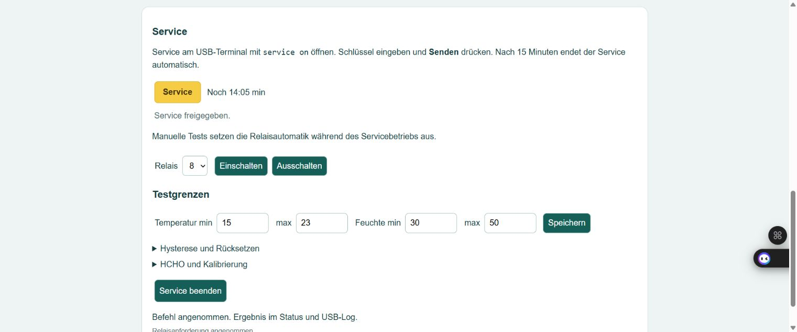

# Bedienungsanleitung – ESP_Klima

Stand: 24.10.2026. Board: Waveshare ESP32-S3-ETH-8DI-8RO.

## 1. Projekt und Firmware

Das Repository enthält das vollständige PlatformIO-Projekt mit Arduino-Framework.
Den Ordner mit `platformio.ini` öffnen; der aktive Code beginnt in `src/main.cpp`.
Die frühere Arduino-Datei in `legacy/` dient nur als Archiv.

PlatformIO Core bzw. die PlatformIO-Erweiterung installieren. In PowerShell im
Projektordner kompilieren und aufspielen:

```powershell
& "$env:USERPROFILE\.platformio\penv\Scripts\platformio.exe" run
& "$env:USERPROFILE\.platformio\penv\Scripts\platformio.exe" run --target upload
& "$env:USERPROFILE\.platformio\penv\Scripts\platformio.exe" device monitor
```

Der ESP verwendet derzeit COM6 und 115200 Baud. Falls Windows eine andere
COM-Nummer vergibt, `upload_port` und `monitor_port` in `platformio.ini` anpassen.
Den seriellen Monitor vor dem Upload mit **Strg+C** schließen. Die benötigten
Bibliotheksversionen sind in `platformio.ini` festgelegt.

Der Testbetrieb verwendet nur Temperatur und Feuchte des vorhandenen SCD41.
CO₂ wird ignoriert. Der spätere SFA40 ist noch nicht integriert; HCHO wird als
ungültig angezeigt. HCHO_MODE führt derzeit zur Störungsmeldung.

## 2. Direktverbindung über Ethernet

ESP und Laptop über Ethernet verbinden. Der vorhandene Testaufbau verwendet:

| Gerät | IPv4 | Netzmaske | Gateway |
|---|---|---|---|
| Laptop, USB-LAN | 192.168.77.1 | 255.255.255.0 | keines |
| ESP | 192.168.77.2 | 255.255.255.0 | keines |

Die ESP-Adresse lässt sich über USB setzen:

```text
network static 192.168.77.2 255.255.255.0 0.0.0.0
```

Danach im Browser **http://192.168.77.2/** öffnen. Für einen Router mit DHCP
stattdessen `network dhcp` senden und die erhaltene Adresse mit `status` auslesen.
Die Netzwerkauswahl bleibt nach einem Neustart gespeichert.

`tools/ConfigureDirectEthernet.ps1` ist auf den vorhandenen USB-LAN-Adapter
abgestimmt. Auf anderen PCs die Adapter-ID zuerst prüfen und anpassen oder die
IPv4-Adresse manuell in den Windows-Adaptereinstellungen eintragen.

## 3. Anzeigen und Relais

Die Oberfläche zeigt Messwerte, Betriebszustand, DI1–DI8 und R1–R8 live an.

| Relais | Automatische Funktion |
|---|---|
| R1 | Alarm bei Temperatur oder Feuchte außerhalb der eingestellten Grenzen |
| R2 | Störung, beispielsweise ungültiger Sensorwert oder ausgefallener Relaistreiber |
| R3 | Bereit/Betrieb: keine Störung, Service geschlossen |
| R4–R8 | Reserve, in Automatik AUS |

**R1 und R3 können gleichzeitig EIN sein:** Das Gerät arbeitet korrekt und meldet
zugleich einen überschrittenen Grenzwert. Beispiel: 43,61 % Feuchte bei maximal
40 % führt zum Alarm. Eine Störung des Geräts liegt dadurch nicht vor.

Die Relaisanzeige zeigt den bestätigten Ausgangsregisterzustand. Sie ist keine
Rückmeldung der mechanischen Kontakte. DI1/DI2 sind für spätere ZERO-/SPAN-Aktionen
vorbereitet; ohne gültigen HCHO-Sensor erfolgt keine Kalibrierung.

## 4. Service freigeben und Relais testen

1. Im USB-Monitor `service on` mit Enter senden.
2. Den ausgegebenen Serviceschlüssel in das Eingabefeld der Webseite eintragen.
3. **Senden** drücken. Bei gültigem Schlüssel verschwinden Eingabe und Senden;
   die gelbe Anzeige **Service** und die verbleibende Zeit erscheinen.
4. Die gewünschte Relaisnummer 1–8 auswählen und **Einschalten** oder
   **Ausschalten** drücken. Die Rückmeldung und Relaisanzeige kontrollieren.
5. Mit **Service beenden** oder USB-Befehl `service off` zur Automatik zurückkehren.

Service läuft höchstens 15 Minuten und beginnt mit **allen Relais AUS**. Während
dieser Zeit sind die Ausgänge manuell gesteuert. Nach dem Ende übernimmt die
Automatik wieder. Die Schlüsselprüfung allein verändert keine Ausgänge und
verlängert die Servicezeit nicht. Nach erneutem Öffnen gilt ein neuer Schlüssel.



## 5. Grenzwerte und Alarm speichern

Im freigegebenen Service die vier Werte unter **Testgrenzen** eingeben und
**Speichern** drücken. Erst der bestätigte Befehl übernimmt die Werte dauerhaft.
Bloßes Ändern der Eingabefelder speichert nichts.

Zuletzt am Gerät ausgelesene Konfiguration vom 24.10.2026:

| Parameter | Gespeicherter Wert |
|---|---|
| Temperatur min / max | 15 / 23 °C |
| Feuchte min / max | 25 / 40 % rF |
| Temperaturhysterese | 0,3 °C |
| Feuchtehysterese | 1,5 Prozentpunkte |
| Alarm speichern | EIN |

Die Standardwerte eines neuen Geräts sind 15–23 °C und 30–50 % rF,
Hysterese 0,3 °C / 2 Prozentpunkte, Alarmspeicherung AUS.
Gespeicherte Geräteeinstellungen haben Vorrang. Die Status-API zeigt die tatsächlich
übernommenen Werte: **http://192.168.77.2/api/status**.

Unter **Hysterese und Rücksetzen** wird festgelegt, wie der Alarm zurückgeht:

- **Automatisch zurücksetzen:** Der Alarm endet, sobald die Messwerte unter
  Berücksichtigung der Hysterese zurückgekehrt sind. Bei maximal 40 % und
  1,5 Prozentpunkten Hysterese ist die obere Rückschaltgrenze 38,5 %.
- **Alarm speichern:** Der Alarm bleibt nach dem Ende der Ursache gespeichert.
  Nach Rückkehr der Werte und Beseitigung möglicher Störungen mit
  **Alarm quittieren** oder USB-Befehl `ack` zurücksetzen.

Um die oben dokumentierte Konfiguration auf einem neuen Board wiederherzustellen,
im USB-Monitor nacheinander senden. Das Öffnen des Service schaltet alle Relais AUS:

```text
service on
limits 15 23 25 40
hysteresis 0.3 1.5
latch on
service off
```

Jede Rückmeldung prüfen. Dezimalzahlen im USB-Monitor mit Punkt schreiben.
Diese Werte sind eine dokumentierte Momentaufnahme; spätere Änderungen am ESP
aktualisieren das GitHub-Repository nicht automatisch.

## 6. Modbus und Diagnose

- **RS485/RTU:** Slave 1, 9600 Baud, 8N1; der USB-RS485-Adapter am Laptop ist derzeit COM9.
- **Ethernet/TCP:** 192.168.77.2, Port 502, Unit-ID 1.
- Beide Schnittstellen lesen denselben Datenstand. Unterstützt werden FC03/FC04;
  Sollwertänderungen über Modbus sind noch nicht implementiert.

Registeradressen, Skalierung und ungültige Werte stehen in [MODBUS.md](MODBUS.md).
USB-Befehle `status`, `registers` und `selftest` dienen der Diagnose. Der Selbsttest
verändert keine realen Ausgänge. Nachgewiesene Tests und noch offene Hardwareprüfungen
stehen im [Prüfprotokoll](PRUEFPROTOKOLL.md).

Bei gesperrten Service-Schaltflächen Verbindung, Restzeit und Schlüssel prüfen.
Bei **Verbindung unterbrochen** zuerst Ethernet-Verbindung und IP-Adressen prüfen.
Die lokale Steuerung arbeitet unabhängig vom Browser weiter.
